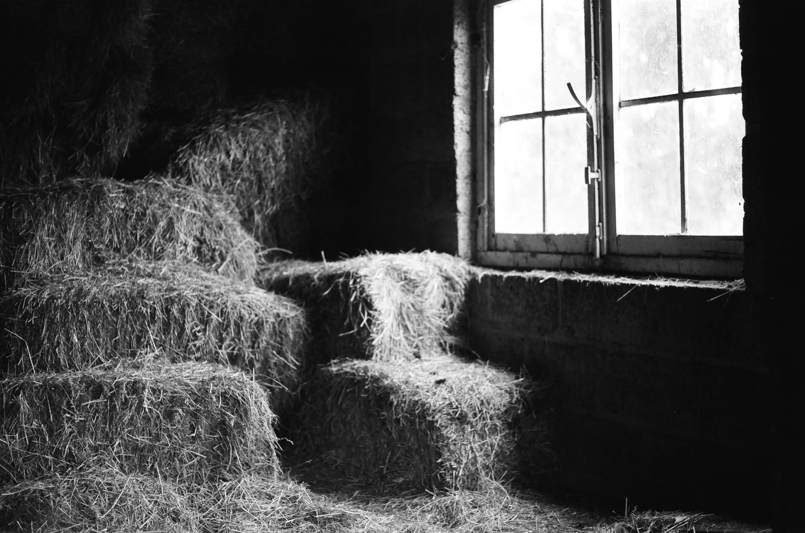

<figure>

<figcaption>Foto por <a href="https://www.pexels.com/photo/pile-of-hay-near-a-glass-window-7618940/">Sinitta Leunen</a>.</figcaption>
</figure>

La vida es un pajar de emociones, todas entreveradas, deslizándose unas sobre otras y, sin embargo, desde fuera todo parece compacto. Los vacíos entre pajas son invisibles pero ahí están, esperando.

Hay noches de insomnio en que el calor se pega a la piel y los minutos pasan lento. Uno espera a que amanezca, pero nada que llega. El corazón se arruga.

Pero se asoma el sol. El pajar sigue ahí.
